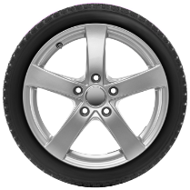

<!DOCTYPE html>
<html lang="en">
<head>
<meta charset="utf-8">
<meta name="viewport" content="width=device-width, initial-scale=1">
<meta name="color-scheme" content="light">
<title>Ugly // Weird Cars of the Week</title>

<!--
  Zet wheel.png in dezelfde map als dit bestand (index.html).
  Wil je een scherper wiel? Vervang wheel.png door een grotere versie met
  dezelfde bestandsnaam: een vierkante PNG met transparante hoeken.
-->

<link rel="preconnect" href="https://fonts.googleapis.com">
<link rel="preconnect" href="https://fonts.gstatic.com" crossorigin>
<link href="https://fonts.googleapis.com/css2?family=Archivo:wdth,wght@62..125,100..900&display=swap" rel="stylesheet">

</head>

<body>

<header class="top" id="top">
  <button class="burger" type="button" aria-label="Menu" aria-expanded="false" aria-controls="menu">
    
    
    
  </button>

  <!-- Pas de href's aan naar je eigen pagina's -->
  <nav class="menu" id="menu" aria-label="Cars of the week" inert>
    <a href="#car-1">1.</a>
    <a href="#car-2">2.</a>
    <a href="#car-3">3.</a>
    <a href="#car-4">4.</a>
    <a href="#car-5">5.</a>
    <a href="#car-6">6.</a>
    <a href="#car-7">7.</a>
  </nav>
</header>

<main>
  <section class="hero">
    <h1 class="title" aria-label="Ugly, weird cars of the week">
      UGLY// WEIRD
      CARS
      
        f the week
      
    </h1>
  </section>

  <section class="intro">
    
An ugly ass selection of a few cars each week

  </section>
</main>

</body>
</html>
